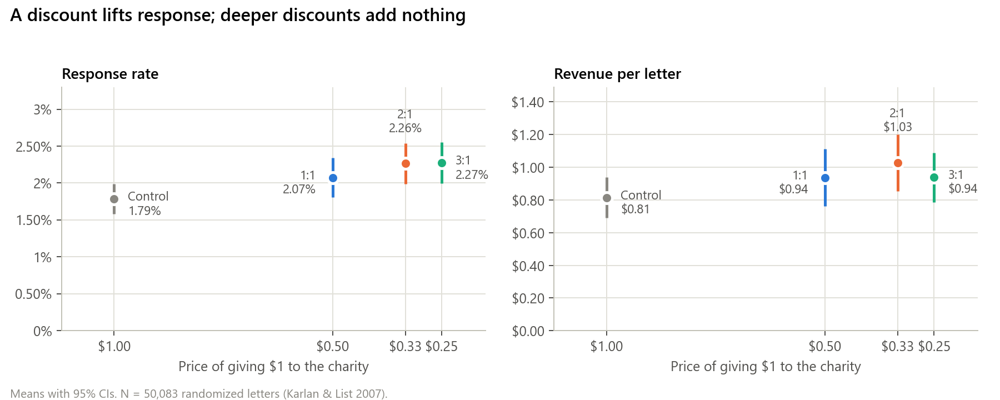
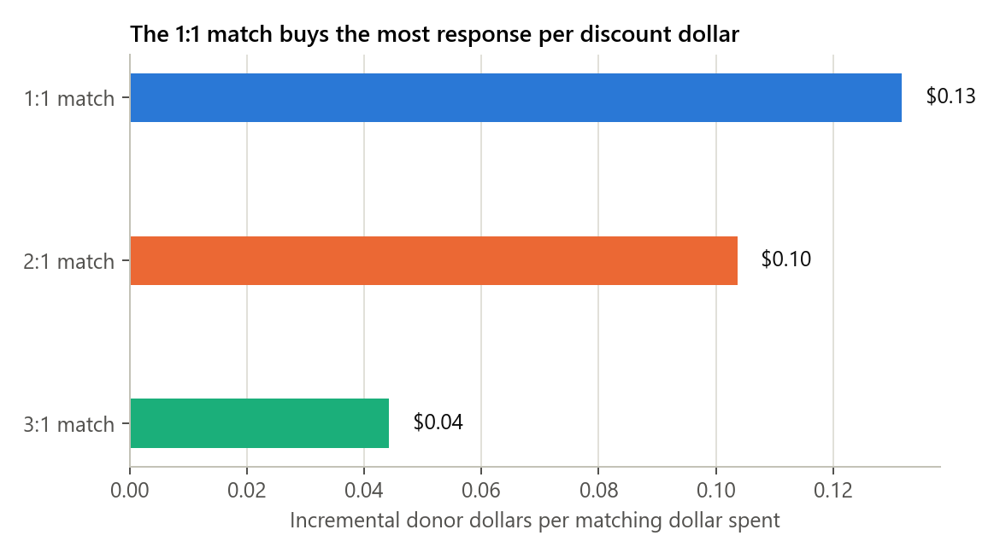
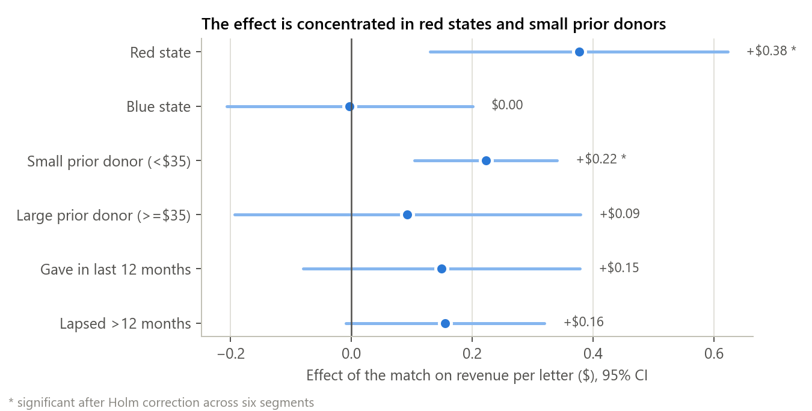
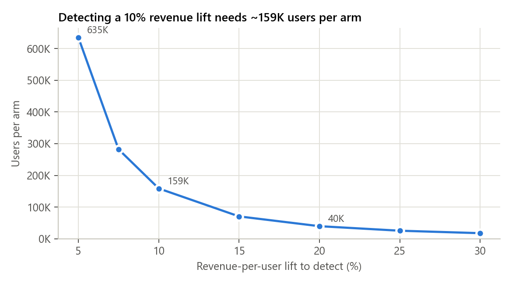

# Pricing Experiments: How Deep Should a Discount Be?

**[Decision memo](MEMO.md)** · Python · statsmodels · 50,083-user randomized multi-arm price test



An end-to-end analysis of a real randomized **price test**, written up as the pricing decision a product team would make from it. The data is Karlan & List's (2007) field experiment, in which 50,083 users were randomized to four price levels: control, plus matching grants that cut the effective price of giving $1 to $0.50, $0.33 or $0.25. Two presentation details were cross-randomized: the stated budget and the suggested-amount anchor.

That makes it the same shape as a fee or discount test on a consumer product:
- multiple price arms
- a low-base-rate conversion metric
- zero-inflated, heavy-tailed revenue per user
- segment heterogeneity
- a discount that has a real cost

## Findings

| | |
|---|---|
| **Any discount works** | Response rose from 1.79% to 2.20% (+23%, p = 0.001). Revenue per user rose from $0.81 to $0.97 (+19%, p = 0.055). |
| **Deeper discounts don't** | 2:1 and 3:1 performed no better than 1:1 (joint p = 0.51). The 1:1 match bought **3× the incremental revenue per discount dollar** of 3:1. |
| **Elasticity** | Participation elasticity is −0.22 (95% CI −0.36 to −0.08). Demand responds to the first price cut, then goes flat. |
| **Targeting beats blanket discounts** | The effect is concentrated in red states (+$0.38 per user, Holm p = 0.01) and among small prior donors. A cross-fitted targeting rule raised **22% more incremental revenue with 35% less discount spend**. |
| **Anchors** | Raising the suggested amount had no measurable effect. |
| **Next test** | Probe *below* 1:1. A 10% revenue-per-user lift needs about 160K users per arm. |

## Methods

- **Experiment integrity:** sample-ratio-mismatch chi-square and a covariate balance table.
- **Arm effects:** OLS with HC2 robust SEs, and Holm correction across the price arms and segments.
- **Demand curve:** arc price elasticity with a bootstrap CI, plus a log-log slope within the discounted arms.
- **Discount economics:** incremental revenue per dollar of discount spend, by arm.
- **Heavy tails:** winsorization at 99% and 99.5%, a percentile bootstrap, and a revenue-concentration check.
- **Variance reduction:** Lin (2013) covariate-adjusted estimator, the regression form of CUPED, using pre-period giving history. It's reported honestly, including that it barely helps on this data.
- **Heterogeneity:** six pre-specified segments with multiple-testing correction and interaction tests.
- **Targeting policy:** learned on one random half, evaluated on the other, then swapped (2-fold cross-fitting), so the value isn't flattered by overfitting.
- **Test design:** sample size per arm for revenue-per-user lifts from 5% to 30%.





## Run it

```bash
python -m venv .venv
.venv/Scripts/pip install -r requirements.txt     # macOS/Linux: .venv/bin/pip
# Download "AER merged.dta" from https://doi.org/10.7910/DVN/27853 (free; short guestbook form)
# and save it as data/raw/karlan_list_2007.dta
.venv/Scripts/python src/analysis.py
.venv/Scripts/python -m pytest -q
```

Outputs go to `outputs/` (`results.json`, `tables/*.csv`, `figures/*.png`). The tests check that the analysis reproduces the published headline numbers.

## Source

Karlan, Dean, and John A. List. 2007. "Does Price Matter in Charitable Giving? Evidence from a Large-Scale Natural Field Experiment." *American Economic Review* 97(5): 1774–1793. Data: Harvard Dataverse, doi:10.7910/DVN/27853, CC0 1.0. The raw file isn't redistributed here; the pipeline expects you to download it. This repository is an independent reanalysis framed as a pricing decision. The causal results are the original authors' design; the decision framing, discount economics, targeting evaluation and test design are added here.
